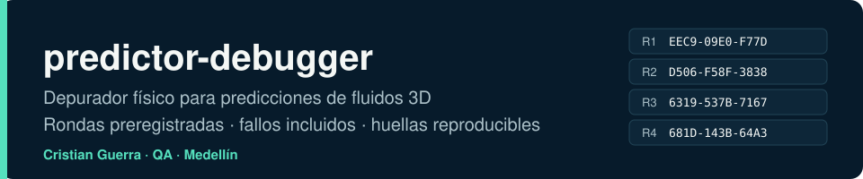
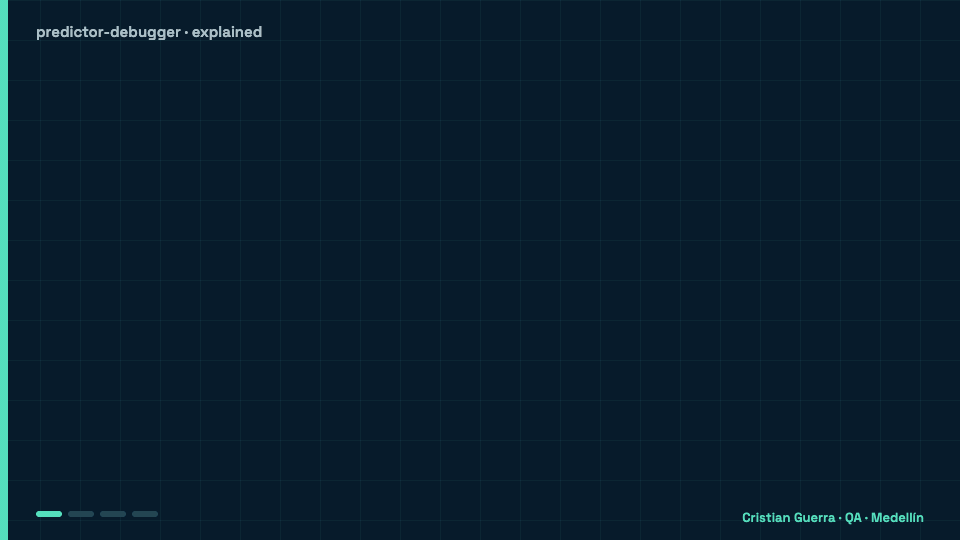
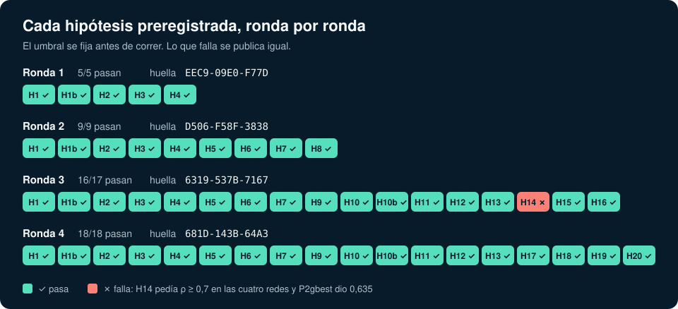
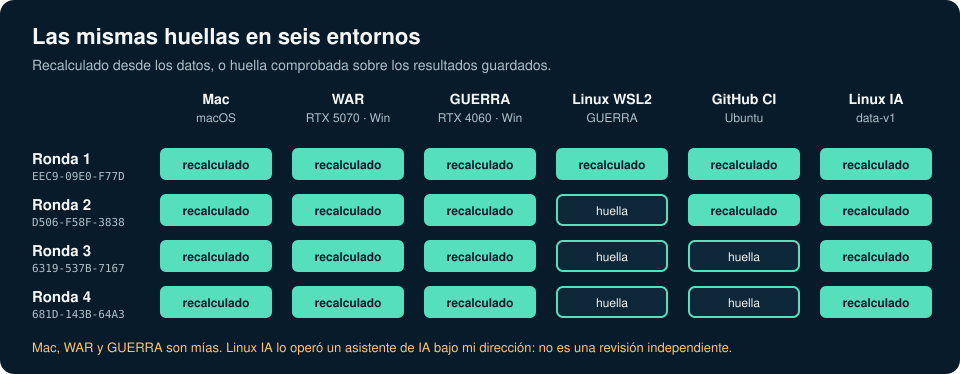

[Leer en español](README.md)



## Explained like you're 8

A neural network is a program that learned to guess how water or air will move a moment later. It guesses fast, but what if it is wrong? This project is a checker that grades its homework with the rules of physics: water can't be squeezed into less space, energy can't appear from nowhere, and each step has to follow the equation of motion. Before looking at the results, I write down the questions and the passing mark, so I can't cheat later. And when a test fails, I publish it too.



### A real example: H14, the bet that failed

- **Imagine** the network does not guess one moment but 20 in a row, like a weather forecast for 20 moments. Each small mistake is carried into the next step.
- **The bet (H14, round 3):** if I add up the error marks the checker gives at each step, that sum should rank which forecasts end up worst. The passing mark was written down beforehand: an average of at least 0.7 on all four networks.
- **What happened:** at step 1 the ranking was almost perfect (0.99), but it wore down to 0.45–0.73 by step 20, and one of the four networks scored 0.635. **H14 failed**, and nothing was changed to fix it. What I learned: the checker knows how wrong the network is at each step, but not where those mistakes push it.
- **What we gain:** the H14 failure is where round 4 starts. There I tried a new idea, H17: carry the direction of each mistake along the 20 steps instead of adding up sizes. It passed on all four networks.

### Hard words

| Word | What it means |
| --- | --- |
| **Neural network (FNO)** | A program that learns from examples to make guesses. FNO is the kind of network used here. |
| **Incompressibility** | Water can't be squeezed: whatever flows into a little piece has to flow out. |
| **Preregister** | Write down the questions and the passing mark before seeing the results. |
| **Hypothesis (H14, H17)** | A named bet that can come out right or wrong. |
| **Rollout** | Letting the network guess many steps in a row, using its own answers. |
| **Fingerprint** | A short code, like `EEC9-09E0-F77D`, that sums up a round's verdicts: if anything changes, the fingerprint changes. |

## What it is

I am Cristian Guerra, a QA engineer in Medellín. This repository contains a debugger that checks whether the predictions of an FNO neural network for a 3D fluid respect incompressibility, the energy balance and the evolution equation. I evaluate it with preregistered hypotheses and thresholds, and I also report the controls that do not pass. Rounds 1 to 4 document those tests and their results.

## How I work

Before generating the test data, I commit the hypotheses and the thresholds. I include comparators that should fail, to check whether the tests tell apart the expected cases. I run the verification on three machines: Mac, WAR and GUERRA. I compare the verdicts and the fingerprint of each round. I keep ledgers of discrepancies and false positives.

## Rounds

| Round | What I tested | Main result | Fingerprint |
| --- | --- | --- | --- |
| 1 | Incompressibility, energy and evolution checks on exact controls, sabotaged predictions and the FNO. | The controls separated and the three machines agreed. D3 detected persistence, but did not rank which FNO steps had more error. The D2 energy balance gave false positives out of distribution. | `EEC9-09E0-F77D` |
| 2 | An error meter G, a more sensitive energy check and predictions with several error levels. | G ranked the error within each predictor and the new balance avoided flagging the exact control. H8 passed when pooling error levels, but did not separate G from D3: D3 also ranked that set. | `D506-F58F-3838` |
| 3 | Detection floors, a G′ alarm and 20-step rollouts. | H14 **FAILED**: the sum of G did not rank the accumulated error across trajectories well enough, and the ΣD3 comparator met the criterion in three of four networks. | `6319-537B-7167` |
| 4 | Transport of the prediction defects along 20-step rollouts. | H17 passed on all four networks: transporting the direction of the defect ranked the rollout error better than summing local norms. The fingerprint repeated on the three machines. | `681D-143B-64A3` |



## Reproduce

Everything runs from the repository root with [uv](https://docs.astral.sh/uv/); `uv run --locked` uses Python 3.9 and numpy 1.26.4, pinned in `uv.lock`. There are three levels, from cheapest to most expensive. Besides my three machines (the Mac, and WAR and GUERRA on Windows), I use a fourth system: Linux, in GitHub CI (`ubuntu-24.04`) and in WSL2 (Ubuntu 24.04) on GUERRA.

### (a) Saved verdicts: minutes, no data

I reapply the preregistered thresholds to the saved statistics of each machine and recompute the fingerprint. Nothing needs to be downloaded:

```sh
uv run --locked verify.py --saved mac
uv run --locked round2/verify.py --saved mac
uv run --locked round3/verify.py --saved mac
uv run --locked round4/verify.py --saved mac
```

Replace `mac` with `war` or `guerra` to see the other machines, or with `linux` in round 1. Each command must print `verdicts equal ...: True` and the fingerprint from the table above. On my Mac, the four rounds in a row took 242 s (about 4 min) on 25 October. The `verify` workflow does this on every push for the three machines and runs the tests of the checks.

### (b) Recompute from the published data and predictions

The data, predictions and checkpoints are not in git. I published them as one tarball per folder in the [`data-v1`](https://github.com/criguex/predictor-debugger/releases/tag/data-v1) release, together with a `SHA256SUMS`. `tools/fetch_data.py` (standard library only) downloads what you ask for, checks each tar against `SHA256SUMS` before extracting it, rejects absolute paths, `..` and links, deletes the tar when done and compares what was extracted with the round's `MANIFEST.sha256`. If something fails, it prints the list and exits with a non-zero code.

```sh
uv run --locked tools/fetch_data.py --rounds r1 --what data preds
uv run --locked verify.py

uv run --locked tools/fetch_data.py --rounds r2 r3 r4 --what data preds
uv run --locked round2/verify.py
uv run --locked round3/verify.py --jobs 2
uv run --locked round4/verify.py --jobs 4
```

Rounds 2 to 4 also read the round 1 validation set (`data/val`), so they need the round 1 data. Each round takes about 5 GB and all four, about 20 GB. Without arguments, `fetch_data.py` downloads everything, checkpoints included. Each `verify.py` compares its verdicts with the ones saved on the Mac and prints the fingerprint, which must be the same.

How long the debugger recomputation took on each machine:

| Round | Mac | WAR | GUERRA | Source |
| --- | --- | --- | --- | --- |
| 1 | 126 s | 257 s | 704 s | [RESULTS.md](RESULTS.md), *Reproducibility across machines* |
| 2 | 585 s | 1,154 s | 3,190 s | [round2/RESULTS.md](round2/RESULTS.md), *Reproducibilidad entre máquinas* |
| 3 | 1,956 s (2 processes) | 3,436 s (6) | 9,457 s (6) | [round3/RESULTS.md](round3/RESULTS.md), *Reproducibilidad entre máquinas* |
| 4 | 3,966 s ≈ 1.1 h (5 processes) | 15,734 s ≈ 4.4 h (6) | 31,223 s ≈ 8.7 h (8) | [round4/RESULTS.md](round4/RESULTS.md), *Reproducibilidad entre máquinas* |

On Linux (WSL2 on GUERRA), the full round 1 took about 7 min: 2 min 52 s of recomputation and 4 min 8 s to regenerate val, test and OOD ([logs/linux/run.log](logs/linux/run.log)). It gave the same verdicts and the fingerprint `EEC9-09E0-F77D` ([logs/linux/verify_saved.log](logs/linux/verify_saved.log)). The `reproduce` workflow (manual or on a `v*` tag) runs this level on a GitHub runner for rounds 1 and 2. In its first run ([run 40267731741](https://github.com/criguex/predictor-debugger/actions/runs/40267731741)), download included, the round 1 job took 6 min 33 s and the round 2 job, 17 min 47 s; both gave the same verdicts and the fingerprints `EEC9-09E0-F77D` and `D506-F58F-3838`.

The four full rounds were recomputed from `data-v1` on another Linux machine, on v1.0 and without retraining. An AI assistant ran it under my direction, so it is not an independent review. It gave the four fingerprints and the same verdicts, including the H14 failure in round 3. The package includes logs, commands, environment and results, and states its limitations: [release repro-ia-20261026](https://github.com/criguex/predictor-debugger/releases/tag/repro-ia-20261026).



The figures are generated from the saved verdicts with `python3 tools/figuras.py`. The animation at the top comes from `docs/scenes/explained.html` with `docs/scenes/export.sh`.

### (c) Regenerate the data and retrain

The data is regenerated from the seeds with the solver in `vendor/`, and each `verify.py` compares the result with its manifest:

```sh
uv run --locked verify.py --regenerate /path/regen --splits train val test ood
uv run --locked round2/verify.py --regenerate /path/regen2
uv run --locked round3/verify.py --regenerate /path/regen3
uv run --locked round4/verify.py --regenerate /path/regen4
```

This level is not bit-identical across systems. No file regenerated on WAR, GUERRA or Linux came out bit-for-bit equal to the Mac's. The largest absolute difference was 8.9e-16 (WAR, round 1, [RESULTS.md](RESULTS.md)); in rounds 2 to 4 it was between 6.7e-16 and 7.8e-16. That is why the Mac files are the canonical ones. The verdicts of the four machines were computed on them and match, with the same fingerprint. Across machines, no statistic differed by more than 4.4e-16 in rounds 1 to 3; in round 4, the maximum was 5.7e-14, in one P0f32 step. In round 1, regenerating the training split took 311 s on the Mac and the other three, 160 s ([logs/mac/data_generation.log](logs/mac/data_generation.log)); on WAR, 732 s and 371 s ([logs/war/regeneration.log](logs/war/regeneration.log)).

Retraining the FNO requires a CUDA GPU and the `train` group (torch 2.7.0): `uv run --locked --group train python -m pd.train --seed 0 --log train_s0.json`, and the same with `--seed 1`. Then, `python -m pd.predictors` builds P3a and P3b. The round 2 networks come from `python -m round2.predict checkpoints` and `python -m round2.predict graded`, and the round 3 and 4 predictions, from `round3/predict.py` and `round4/predict.py`. I trained only once, on WAR (RTX 5070); the two round 1 seeds took 102.6 s and 136.8 s ([RESULTS.md](RESULTS.md)). I did not aim for bit-identical weights across devices, so retraining gives new networks: it is new evidence, not a copy of my bits.

## Round 5: blind test

I invite anyone who wants to take part to prepare pairs of correct and sabotaged states following [round5/KIT.md](round5/KIT.md) (in Spanish). The kit explains how to commit the labels before handing over the pairs.

## What would prove me wrong

- **Round 5, blind.** The debugger silently lets through a pair sabotaged by someone else, or flags a correct state as bad. The labels are committed with their hash before I see the pairs.
- **Another regime.** In chaotic flows, long horizons or networks trained for rollout, transporting the defect (H17) stops ranking the error better than summing local norms.
- **Another person.** Someone who is not me downloads `data-v1` on their machine and gets a different fingerprint or different verdicts.

## Limits

The scope is a 32³ periodic box, smooth initial fields, a short horizon, one architecture and no forcing. This says nothing about the Clay problem, the OpenAI proof or real turbulence. The data and predictions take about 20 GB and are not in git; they are in the `data-v1` release and the repository keeps their hashes. The three machines are mine, so this is not an independent reproduction. I wrote and ran this work with help from AI assistants, under my direction.

My sister project is [scientific-qa-evidence](https://criguex.github.io/scientific-qa-evidence/).
